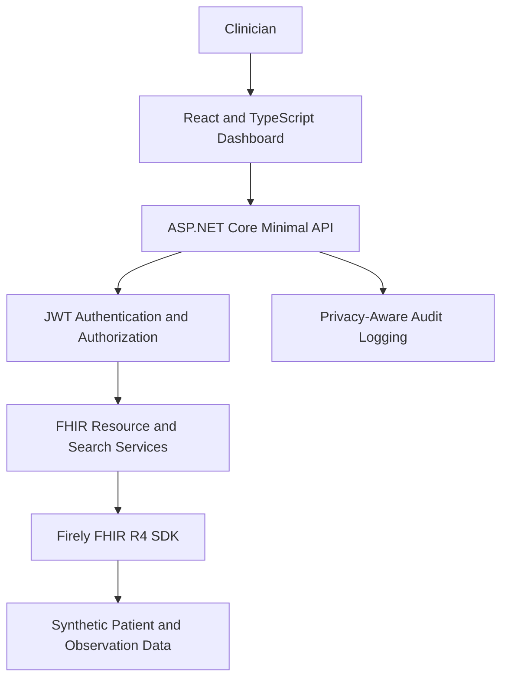

# RehabConnect

A full-stack digital health prototype for rehabilitation monitoring, demonstrating healthcare interoperability using HL7 FHIR R4, secure API development and clinician-facing data visualisation.

## Project Overview

RehabConnect explores how modern software engineering and healthcare interoperability standards can support digital rehabilitation services.

The application enables clinicians to search for patients, retrieve rehabilitation observations and visualise pain score trends over time through a secure web-based dashboard.

This project was developed to gain practical experience in digital health architecture, FHIR-based interoperability and healthcare-focused software engineering.

## Key Features

- Clinician-facing React dashboard.
- Patient search by family name.
- FHIR R4 Patient and Observation resources.
- Pain score visualisation and historical trend charts.
- FHIR search responses using Bundle resources.
- Structural validation of FHIR resources.
- Standardised error handling using FHIR OperationOutcome.
- Development JWT authentication.
- Role-based access control for Clinician and Admin roles.
- Privacy-aware API audit logging.
- Automated unit and integration testing.

## Technology Stack

| Layer                       | Technology                              |
| --------------------------- | --------------------------------------- |
| Frontend                    | React, TypeScript, Vite                 |
| Backend                     | C#, .NET 10, ASP.NET Core Minimal API   |
| Healthcare Interoperability | HL7 FHIR R4                             |
| FHIR SDK                    | Firely .NET SDK                         |
| Authentication              | JWT Bearer Authentication               |
| Authorization               | Role-Based Access Control               |
| Testing                     | xUnit, ASP.NET Core Integration Testing |
| Development Environment     | Visual Studio 2026                      |
| Source Control              | Git, GitHub                             |
| API Documentation           | OpenAPI                                 |

## System Architecture



The frontend communicates with the backend through authenticated HTTP requests. The backend uses the Firely SDK to represent and serialise healthcare information using FHIR R4 resources.

The architecture separates presentation, API handling, authentication and healthcare resource processing to support maintainability and future extension.

## FHIR API Endpoints

| Method | Endpoint                                | Description                    |
| ------ | --------------------------------------- | ------------------------------ |
| GET    | `/fhir/Patient/{id}`                    | Retrieve a patient             |
| GET    | `/fhir/Patient?family=Smith`            | Search patients by family name |
| GET    | `/fhir/Observation/{id}`                | Retrieve an observation        |
| GET    | `/fhir/Observation?patient=patient-001` | Retrieve patient observations  |

FHIR resources are returned using the `application/fhir+json` media type.

## Rehabilitation Monitoring

The dashboard demonstrates longitudinal pain score monitoring using synthetic rehabilitation observations.

| Date            | Pain Score |
| --------------- | ---------- |
| 2 October 2026  | 8/10       |
| 9 October 2026  | 6/10       |
| 16 October 2026 | 5/10       |
| 23 October 2026 | 4/10       |

These observations demonstrate how clinicians could visualise changes in patient-reported pain scores over time.

All patient information and observations are synthetic.

## Security and Privacy

The application incorporates several security-focused engineering practices:

- JWT bearer authentication.
- Role-based endpoint authorization.
- Privacy-aware audit logging.
- Avoidance of patient identifiers and authentication tokens in audit logs.
- Environment-specific configuration.
- Exclusion of local secrets and generated files from source control.

Authentication currently uses development JWTs for local demonstration. Production identity management and additional healthcare security controls are planned enhancements.

## Project Structure

```text
RehabConnect/
├── RehabConnect.Api/
│   ├── Fhir/
│   └── Program.cs
├── RehabConnect.Tests/
├── rehabconnect-web/
│   ├── src/
│   │   ├── components/
│   │   ├── services/
│   │   └── App.tsx
│   └── package.json
├── .gitignore
└── README.md
```

## Getting Started

### Prerequisites

- .NET 10 SDK
- Node.js 22 or compatible supported version
- npm
- Git
- Visual Studio 2026 (optional)

### Clone the Repository

```bash
git clone https://github.com/harshaddave13/RehabConnect.git
cd RehabConnect
```

### Run the Backend

```bash
dotnet restore
dotnet dev-certs https --trust
dotnet run --project RehabConnect.Api --launch-profile https
```

The local API is configured to use:

```text
https://localhost:7102
```

### Generate a Development JWT

From the repository root:

```bash
dotnet user-jwts create --project RehabConnect.Api --role Clinician --output token
```

Copy the generated token securely and enter it into the dashboard's development authentication field.

Never commit authentication tokens or credentials to source control.

### Run the Frontend

Open a separate terminal:

```bash
cd rehabconnect-web
npm ci
npx vite --host 127.0.0.1 --port 5173
```

Open:

```text
http://127.0.0.1:5173
```

The Vite development proxy forwards FHIR requests to the local ASP.NET Core API.

## Automated Testing

The backend includes 25 passing automated tests covering:

- FHIR resource structural validation.
- Patient and Observation search.
- API response handling.
- Authentication and authorization.
- Privacy-aware audit logging.
- HTTP integration testing.

Run the tests from the repository root:

```bash
dotnet test
```

Verify the frontend production build:

```bash
cd rehabconnect-web
npm run build
```

## Development Roadmap

Planned enhancements include:

- Persistent healthcare data storage.
- Production identity management using OpenID Connect.
- Microsoft Azure deployment.
- CI/CD pipelines using GitHub Actions.
- Expanded frontend automated testing.
- Additional FHIR resources and profile validation.
- Exploration of NHS interoperability requirements.
- Patient-reported outcome measures.
- Accessibility and clinical usability improvements.
- Production monitoring and observability.

## Project Status and Disclaimer

RehabConnect is an independent digital health portfolio and learning project.

It demonstrates practical software engineering, healthcare interoperability and security concepts using synthetic data.

It is not connected to NHS systems, has not undergone clinical safety assessment or regulatory approval, and is not intended for clinical decision-making or processing real patient information.

## Author

**Harshad Dave**

Full Stack Software Engineer with experience in .NET, Azure, enterprise applications, technical leadership and AI-enabled software solutions.

GitHub: [github.com/harshaddave13](https://github.com/harshaddave13)
